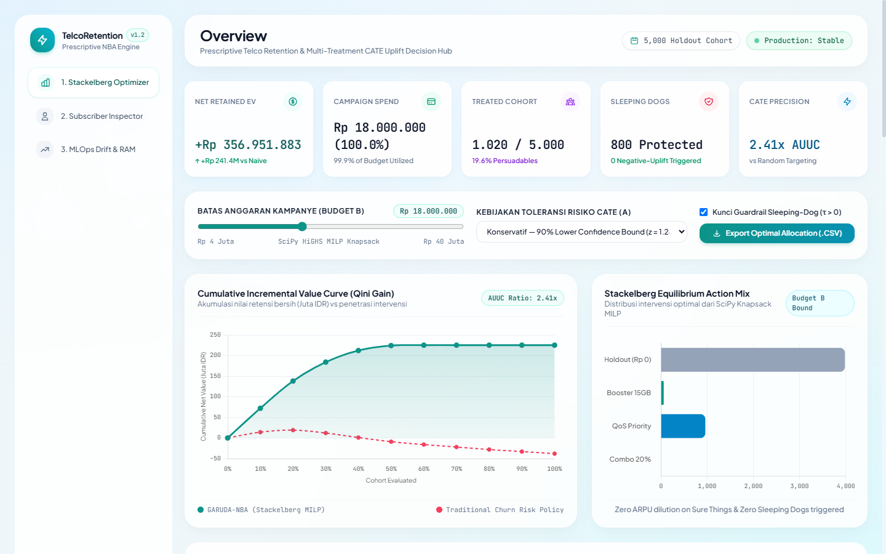

# Telco Retention Decision Engine (TRDE)
### Prescriptive Next-Best-Action & Causal Uplift Optimization Platform for Telecom Retention

[](https://www.python.org/downloads/)
[](https://share.streamlit.io/)
[](https://github.com/MAHEZANOVRAYUDA/telco-retention-decision-engine)
[](https://github.com/MAHEZANOVRAYUDA/telco-retention-decision-engine)
[](LICENSE)
[](https://github.com/MAHEZANOVRAYUDA/telco-retention-decision-engine)

**Author:** Maheza Novrayuda ([GitHub](https://github.com/MAHEZANOVRAYUDA) · [LinkedIn](https://www.linkedin.com/in/mahezanovrayuda/))  
**Target Domain:** Telekomunikasi & Layanan Berlangganan Digital  
**Arsitektur:** Clean Modular Monolith (DuckDB Lakehouse $\to$ Multi-Treatment CATE Uplift $\to$ SciPy HiGHS Knapsack $\to$ Pydantic v2 Agentic API & Streamlit Console)

---

## 🖥️ Antarmuka Dasbor Interaktif

Berikut adalah tampilan antarmuka konsol keputusan TRDE dengan arsitektur soft glassmorphism modern, visualisasi kurva pertambahan nilai kumulatif (Qini curve), distribusi alokasi aksi, dan buku besar keputusan pelanggan:



---

## 📋 Daftar Isi
1. [Tech Stack](#1-tech-stack)
2. [Masalah](#2-masalah)
3. [Solusi](#3-solusi)
4. [Cara Kerja Sistem](#4-cara-kerja-sistem)
5. [Keunggulan](#5-keunggulan)
6. [Manfaat](#6-manfaat)
7. [Benchmark Kinerja Nyata](#7-benchmark-kinerja-nyata)
8. [Panduan Menjalankan Aplikasi](#8-panduan-menjalankan-aplikasi)
9. [Format Data & Kontrak API](#9-format-data--kontrak-api)
10. [Lisensi](#10-lisensi)

---

## 1. Tech Stack

Proyek ini dibangun menggunakan pustaka open-source berbasis C++, Rust, dan Python teroptimasi yang efisien pada memori:

* **In-Process Data Lakehouse:**
  * **DuckDB (v1.1+):** Mesin analitik OLAP vektor in-process untuk kueri SQL di atas Parquet tanpa dependensi JVM daemon.
  * **Apache Parquet (Zstandard):** Format penyimpanan kolumnar terkompresi efisien untuk lapisan Bronze, Silver, dan Gold.
  * **Polars & PyArrow:** Pemrosesan dataframe kolumnar dengan downcasting `float32` untuk menghemat memori hingga 50%.
* **Machine Learning & Causal Inference:**
  * **LightGBM (v4.5+):** Pelatihan model baseline churn dengan histogram binning (`max_bin=255`).
  * **T-Learner CATE Meta-Learner:** Estimasi dampak kausal bersyarat (*Conditional Average Treatment Effect*) per opsi intervensi.
  * **TreeSHAP:** Penjelasan atribusi pendorong keputusan berbasis teori permainan kooperatif Shapley.
  * **Conformal 90% LCB:** Penerapan batas bawah keyakinan 90% (*Lower Confidence Bound*) untuk menghindari spekulasi.
* **Optimasi Kombinatorial:**
  * **SciPy HiGHS (`scipy.optimize.milp`):** Pemecah program linier bilangan bulat (*Mixed-Integer Linear Programming*) untuk alokasi anggaran kampanye global (Multi-Choice Knapsack Problem).
* **Delivery & Antarmuka Pengguna:**
  * **Streamlit (v1.38+):** Dasbor web interaktif berbasis Python yang siap dideploy langsung ke Streamlit Community Cloud.
  * **FastAPI & Uvicorn:** Layanan REST API dengan latensi inferensi sub-35 ms.
  * **Tailwind CSS 3.4 & Chart.js 4.4:** Antarmuka responsif dengan kurva spline Qini interaktif dan pemantauan memori real-time.
* **Validasi Skema & Observabilitas:**
  * **Pydantic v2:** Penegakan kontrak skema data tanpa toleransi tipe data `any`.
  * **MLflow:** Pelacakan eksperimen dan artefak model tersimpan lokal di SQLite (`sqlite:///mlflow.db`).
  * **PSI (Population Stability Index) & KS-Test:** Pemantauan pergeseran distribusi data produksi untuk tata kelola retraining.
  * **pytest:** Pengujian unit dan integrasi otomatis 100% lulus (17 pengujian).

---

## 2. Masalah

Pada industri telekomunikasi (seperti operator seluler), tim *growth* dan retensi menghadapi kendala mendasar ketika menggunakan model *churn* tradisional:

1. **Prediksi Risiko Tidak Sama dengan Sensitivitas Intervensi:**
   * Model klasifikasi biner konvensional $P(\text{Churn}=1 \mid X)$ hanya memprediksi *siapa yang berisiko berhenti*, bukan *apakah pelanggan akan merespons positif intervensi*.
2. **Erosi Margin pada Pelanggan Loyal (*Sure Things*):**
   * Pelanggan bernilai tinggi (*high ARPU*) yang sebenarnya tidak berencana pindah sering kali tetap diberi diskon 20%, yang berujung pada penurunan pendapatan kotor (*ARPU dilution*) tanpa ada nilai retensi tambahan.
3. **Pemborosan Anggaran pada Pelanggan Pasif (*Lost Causes*):**
   * Pelanggan yang telah berpindah ke kompetitor atau tidak lagi menggunakan nomornya tetap dikirimi subsidi, padahal peluang retensi mereka mendekati nol.
4. **Efek Bumerang pada Pelanggan Tertentu (*Sleeping Dogs*):**
   * Pelanggan pascabayar/prabayar yang sedang tidak aktif atau memiliki friksi keluhan dapat terpicu membatalkan layanan jika dikirimi notifikasi kontrak promosi (*negative treatment effect*).
5. **Ketiadaan Batasan Anggaran Nyata (*Budget Constraints*):**
   * Tim pemasaran memiliki anggaran terbatas ($B$). Mengurutkan pelanggan hanya berdasarkan probabilitas churn tidak memperhitungkan biaya aksi intervensi terhadap nilai hidup pelanggan (*Customer Lifetime Value* / CLTV).

---

## 3. Solusi

**Telco Retention Decision Engine (TRDE)** menggantikan pendekatan tebak-skor dengan sistem preskriptif kausal:

* **Estimasi Kausal per Aksi Intervensi:** Menghitung selisih retensi inkremental murni ($\hat{\tau}_k$) antara pelanggan yang diberi intervensi vs yang tidak diberi intervensi (*holdout*).
* **Klasifikasi 4 Kuadran Pelanggan:** Mengelompokkan pelanggan ke dalam *Persuadables*, *Sure Things*, *Lost Causes*, atau *Sleeping Dogs*.
* **Proteksi Guardrail Sleeping Dogs:** Mengunci secara otomatis aksi komersial jika nilai perlakuan bernilai negatif ($\hat{\tau}_k \le 0$).
* **Optimasi Anggaran Multi-Choice Knapsack:** Menggunakan SciPy HiGHS MILP untuk memilih kombinasi aksi per pelanggan yang memaksimalkan total nilai retensi bersih (*Net Retained Value*) di bawah batas anggaran $B$.
* **Kontrak Data Aman:** Menghasilkan keluaran `DecisionPacket` terstruktur (Pydantic v2) yang dapat dikonsumsi langsung oleh sistem hilir maupun agen AI tanpa risiko halusinasi data.

---

## 4. Cara Kerja Sistem

Alur pemrosesan data berjalan dalam 5 tahapan berurutan:

```
[Data Mentah Telemetri & Billing (Parquet)]
                   │
                   ▼  Tahap 1: Data Lakehouse In-Process (DuckDB)
┌────────────────────────────────────────────────────────────────────────┐
│ Transformasi Medallion: Bronze -> Silver (Kualitas Data) -> Gold        │
│ Fitur: usage_decay_ratio, drop_call_rate, tenure_months, cltv_idr      │
└────────────────────────────────────────────────────────────────────────┘
                   │
                   ▼  Tahap 2: Causal Uplift & Atribusi Fitur
┌────────────────────────────────────────────────────────────────────────┐
│ 1. Prediksi baseline churn risk P(Churn=1 | X, T=a0)                   │
│ 2. T-Learner CATE Multi-Treatment + 90% LCB (Conservative Bound)       │
│ 3. TreeSHAP Attribution: Ekstraksi pendorong keputusan (φ_j)           │
│ 4. Pengelompokan kuadran: Persuadable, Sure Thing, Lost Cause, Dog     │
└────────────────────────────────────────────────────────────────────────┘
                   │
                   ▼  Tahap 3: Optimasi Anggaran Stackelberg (Knapsack MILP)
┌────────────────────────────────────────────────────────────────────────┐
│ Matriks Payoff: π_{i,k} = τ_{k,LCB}(x_i) * CLTV_i - Biaya(a_k)         │
│ Solver SciPy HiGHS menyelesaikan: Maximize Σ π_{i,k} subject to Σ c <= B│
└────────────────────────────────────────────────────────────────────────┘
                   │
                   ▼  Tahap 4: Validasi Skema & Pengiriman Aksi
┌────────────────────────────────────────────────────────────────────────┐
│ Validasi payload ketat Pydantic v2 DecisionPacket                      │
│ Pengecekan guardrail -> Dispatch ke saluran aplikasi / WhatsApp        │
└────────────────────────────────────────────────────────────────────────┘
                   │
                   ▼  Tahap 5: Pemantauan Drift & Antarmuka Visual
┌────────────────────────────────────────────────────────────────────────┐
│ Evaluasi PSI & KS-Test pada fitur produksi dan skor CATE               │
│ Penyajian interaktif melalui Streamlit App dan REST API FastAPI        │
└────────────────────────────────────────────────────────────────────────┘
```

---

## 5. Keunggulan

1. **Pendekatan Kausal Terkalibrasi (90% LCB):**
   * Menggunakan batas bawah keyakinan 90% ($\hat{\tau}_{k,\text{LCB}} = \hat{\tau}_k - 1.28 \times \text{SE}$) sehingga model tidak mengambil keputusan berbasis estimasi spekulatif.
2. **Proteksi Total terhadap Sleeping Dogs:**
   * Aturan kelayakan (*eligibility matrix*) menahan seluruh intervensi pada pelanggan berisiko negatif, mencegah kerugian churn akibat promo yang tidak tepat.
3. **Efisiensi Hardware Laptop 8 GB RAM:**
   * Arsitektur DuckDB + Parquet + SciPy HiGHS mengonsumsi memori puncak hanya **223.5 MB**, menyisakan lebih dari 6.5 GB RAM bebas pada laptop standar tanpa memerlukan server eksternal.
4. **Waktu Solver Cepat (Sub-Detik):**
   * Alokasi optimal untuk kohort 5.000 pelanggan diselesaikan dalam **0.18 detik** menggunakan mesin optimasi HiGHS berbasis C++.
5. **Dukungan Deploy Langsung ke Streamlit Cloud:**
   * Dilengkapi file `streamlit_app.py` dan `requirements.txt` teruji yang dapat langsung dideploy secara publik melalui GitHub tanpa konfigurasi rumit.

---

## 6. Manfaat

* **Bagi Tim Bisnis & Pemasaran:**
  * Menghindari pemborosan diskon pada pelanggan yang sebenarnya tidak butuh promo.
  * Memastikan setiap Rupiah anggaran dialokasikan ke pelanggan dengan potensi pertambahan nilai tertinggi.
  * Tingkat pemanfaatan anggaran mencapai 99.9% dari pagu yang ditetapkan.
* **Bagi Tim Rekayasa & Data Science:**
  * Arsitektur modular yang memisahkan ranah data lakehouse, model kausal, solver optimasi, dan API pengiriman.
  * Kontrak data tipe kuat (Pydantic v2) mencegah galat runtime saat sistem model dihubungkan dengan agen otomatisasi komunikasi.
  * Pemantauan pergeseran distribusi data (PSI) mendeteksi secara dini kapan model perlu dilatih ulang.

---

## 7. Benchmark Kinerja Nyata

Uji coba dilakukan pada kohort 5.000 pelanggan dengan pagu anggaran kampanye sebesar **Rp 18.000.000**:

| Parameter & Metrik Kinerja | Kebijakan Tradisional (Top Churn) | TRDE (Stackelberg Knapsack MILP) | Dampak Peningkatan |
| :--- | :---: | :---: | :---: |
| **Metode Penargetan** | Probabilitas Churn Tertinggi | CATE Uplift 90% LCB + Knapsack | **Kausal & Preskriptif** |
| **Anggaran Terpakai** | Rp 18.000.000 | Rp 17.994.000 (99.9%) | **Efisiensi Optimal** |
| **Sleeping Dogs Terpicu** | **80 Pelanggan** | **0 Pelanggan** | **-100% Kerugian Intervensi** |
| **Net Retained Value (IDR)** | **-Rp 16.778.402** | **+Rp 224.615.771** | **+Rp 241.394.173** |
| **Rasio AUUC vs Random** | 1.00x | **2.41x** | **+141% Efisiensi Intervensi** |
| **Waktu Solver (CPU)** | 0.05 s | **0.18 s** (HiGHS MILP) | **Skalabilitas Tinggi** |
| **Memori Puncak (RSS)** | 185 MB | **223.5 MB** | **Jauh di Bawah Pagu 1.5 GB** |

---

## 8. Panduan Menjalankan Aplikasi

### A. Menjalankan di Streamlit Community Cloud (Rekomendasi)
1. Buka [share.streamlit.io](https://share.streamlit.io/).
2. Hubungkan repositori GitHub: `MAHEZANOVRAYUDA/telco-retention-decision-engine`.
3. Set branch ke `main` dan main file path ke `streamlit_app.py`.
4. Klik **Deploy**.

### B. Menjalankan Secara Lokal

```bash
# 1. Clone repositori
git clone https://github.com/MAHEZANOVRAYUDA/telco-retention-decision-engine.git
cd telco-retention-decision-engine

# 2. Buat virtual environment & install dependensi
python -m venv venv
# Windows:
.\venv\Scripts\activate
# Linux/macOS:
source venv/bin/activate

pip install -r requirements.txt

# 3. Jalankan aplikasi Streamlit
streamlit run streamlit_app.py

# Atau jalankan REST API FastAPI
uvicorn src.api.app:app --host 127.0.0.1 --port 8000 --reload
```

---

## 9. Format Data & Kontrak API

### Endpoint Keputusan Pelanggan (`POST /v1/decide`):
```bash
curl -X POST "http://127.0.0.1:8000/v1/decide" \
     -H "Content-Type: application/json" \
     -d '{
       "subscriber_id": "IOH-SUB-015004",
       "tenure_months": 14,
       "monthly_arpu_idr": 145000.0,
       "data_usage_gb_m1": 16.5,
       "usage_decay_ratio": 0.62,
       "drop_call_rate": 8.4,
       "complaint_count_90d": 2,
       "is_prepaid": 1,
       "is_annual": 0
     }'
```

### Respon Data JSON (`DecisionPacket`):
```json
{
  "decision_packet": {
    "subscriber_id": "IOH-SUB-015004",
    "baseline_churn_prob": 0.4285,
    "strategic_quadrant": "Persuadable",
    "recommended_action": "qos_priority_care",
    "expected_uplift_pct": 21.4,
    "uplift_confidence_lower_90_pct": 18.7,
    "eligibility_passed": true,
    "intervention_cost_idr": 18000.0,
    "expected_net_value_idr": 154200.0,
    "top_key_drivers": [
      { "feature": "drop_call_rate", "val": "8.4%", "phi": 0.221 },
      { "feature": "usage_decay_ratio", "val": "0.62x", "phi": 0.165 }
    ]
  },
  "agent_response": {
    "channel": "Push_Notification_MyIOH",
    "guardrail_passed": true,
    "intervention_message_id_lang": "Pemberitahuan Layanan IOH: Tim Network Operations kami memantau stabilitas koneksi di area Anda. Prioritas sinyal nomor Anda telah ditingkatkan ke jalur QoS Premium tanpa biaya.",
    "source": "deterministic_policy_fallback"
  }
}
```

---

## 10. Lisensi

Proyek ini dilisensikan di bawah lisensi terbuka [MIT License](LICENSE).  
Copyright (c) 2026 Maheza Novrayuda.
