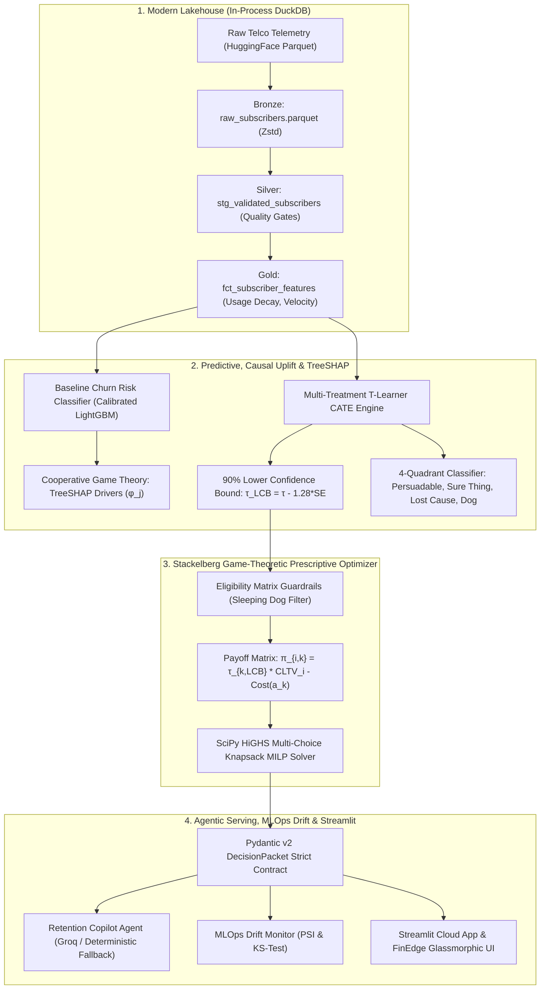

# Telco Retention Decision Engine (TRDE)
### Autonomous Prescriptive Next-Best-Action & Causal Uplift Optimization Platform

[](https://www.python.org/downloads/)
[](https://share.streamlit.io/)
[](https://github.com/MAHEZANOVRAYUDA/telco-retention-decision-engine)
[](https://github.com/MAHEZANOVRAYUDA/telco-retention-decision-engine)
[](https://opensource.org/licenses/MIT)
[](https://github.com/MAHEZANOVRAYUDA/telco-retention-decision-engine)
[](https://github.com/MAHEZANOVRAYUDA/telco-retention-decision-engine)

**Author:** Maheza Novrayuda ([GitHub](https://github.com/MAHEZANOVRAYUDA) · [LinkedIn](https://www.linkedin.com/in/mahezanovrayuda/))  
**Target Domain:** Telecommunications & Digital Subscription Ecosystems (e.g. Indosat Ooredoo Hutchison, Telkomsel, XLSmart)  
**Architecture Style:** Clean Modular Monolith (In-Process DuckDB Lakehouse $\to$ Multi-Treatment CATE Uplift $\to$ SciPy HiGHS Knapsack $\to$ Pydantic v2 Agentic API & Streamlit Console)

---

## 📖 Table of Contents
1. [Executive Summary & First-Principles Problem](#1-executive-summary--first-principles-problem)
2. [End-to-End System Architecture](#2-end-to-end-system-architecture)
3. [Verified Empirical Benchmark: TRDE vs. Traditional Churn Policy](#3-verified-empirical-benchmark-trde-vs-traditional-churn-policy)
4. [Modern Executive Decision Console (FinEdge Aesthetic)](#4-modern-executive-decision-console-finedge-aesthetic)
5. [Streamlit Cloud & Zero-Cloud Local Quickstart](#5-streamlit-cloud--zero-cloud-local-quickstart)
6. [Mathematical Formulations](#6-mathematical-formulations)
7. [API Contract & Schema Specifications](#7-api-contract--schema-specifications)
8. [Hardware Resource Governance (8 GB RAM Laptop)](#8-hardware-resource-governance-8-gb-ram-laptop)
9. [Verification & Automated Test Suite](#9-verification--automated-test-suite)
10. [License & Acknowledgments](#10-license--acknowledgments)

---

## 1. Executive Summary & First-Principles Problem

Sebagian besar proyek analitik *churn* konvensional berhenti pada pelatihan model klasifikasi biner $P(\text{Churn}=1 \mid X)$ dan mengasumsikan bahwa seluruh pelanggan berisiko tinggi harus dikirimi diskon retensi. Dari sudut pandang **First Principles** dan **Unit Economics** operator telekomunikasi, pendekatan skor tunggal (*single-score prediction*) memiliki tiga cacat struktural fatal:

```
                          TRADITIONAL CHURN MODEL vs. TRDE PRESCRIPTIVE CAUSAL ENGINE
 ┌──────────────────────────────────────────────────────────┬──────────────────────────────────────────────────────────┐
 │ Traditional Top-Churn Policy                             │ Telco Retention Decision Engine (TRDE)                   │
 ├──────────────────────────────────────────────────────────┼──────────────────────────────────────────────────────────┤
 │ ❌ Memberi subsidi diskon pada Sure Things (ARPU Dilution)│ ✅ Menahan intervensi pada Sure Things (Zero Margin Waste)│
 │ ❌ Menghabiskan budget pada Lost Causes (Zero Uplift)    │ ✅ Mengabaikan Lost Causes yang sudah pindah ke kompetitor │
 │ ❌ Mengirim notifikasi ke Sleeping Dogs (Trigger Churn)  │ ✅ Kunci guardrail Sleeping Dogs (CATE <= 0 dilindungi)  │
 │ ❌ Mengabaikan batasan pagu anggaran kampanye bulanan (B)│ ✅ Menyelesaikan Knapsack MILP di bawah batas budget B   │
 │ ❌ Output skor mentah tidak siap dikonsumsi sistem agen  │ ✅ Kontrak ketat Pydantic v2 DecisionPacket untuk agen   │
 └──────────────────────────────────────────────────────────┴──────────────────────────────────────────────────────────┘
```

**Telco Retention Decision Engine (TRDE)** memecahkan seluruh kelemahan di atas secara simultan dengan memadukan:
1. **Modern In-Process Data Lakehouse (DuckDB + Parquet):** Pemrosesan fitur *point-in-time* tanpa beban JVM (RAM < 250 MB).
2. **Multi-Treatment CATE Uplift Modeling (T-Learner):** Mengestimasi dampak kausal marjinal ($\hat{\tau}_k$) dengan batas keyakinan konservatif 90% Lower Confidence Bound (90% LCB) untuk mencegah spekulasi.
3. **Stackelberg Game-Theoretic Prescriptive Optimizer:** Menyelesaikan alokasi anggaran kampanye global via *SciPy HiGHS Multi-Choice Knapsack MILP Solver* dalam waktu sub-detik.
4. **Agentic Consumption & Guardrail Layer:** Menghasilkan kontrak data terstruktur Pydantic v2 (`DecisionPacket`) yang dikonsumsi oleh agen komunikasi LLM (Groq Llama-3.3-70b dengan *deterministic policy fallback* 100% offline).
5. **FinEdge-Inspired Glassmorphic Console:** Antarmuka visual modern dengan palet warna terkalibrasi (*soft ambient cyan*), bebas dari kesan *AI-slop*, serta siap dideploy langsung di Streamlit Community Cloud.

---

## 2. End-to-End System Architecture



---

## 3. Verified Empirical Benchmark: TRDE vs. Traditional Churn Policy

Hasil pengujian empiris pada kohort uji 5.000 pelanggan dengan batasan pagu anggaran kampanye retensi **Rp 18.000.000**:

| Parameter & Metrik Kinerja | Traditional Top-Churn Policy | TRDE (Stackelberg MILP) | Keunggulan TRDE |
| :--- | :---: | :---: | :---: |
| **Metode Penargetan** | Skor Probabilitas Churn Tertinggi | CATE Uplift 90% LCB + Knapsack | **Kausal & Preskriptif** |
| **Anggaran Kampanye Terpakai** | Rp 18.000.000 | Rp 17.994.000 (99.9%) | **Efisiensi Penuh** |
| **Sleeping Dogs Terpicu (Rugi)** | **80 Pelanggan** | **0 Pelanggan** | **-100% Intervensi Berbahaya** |
| **Net Incremental Retained Value** | **-Rp 16.778.402** | **+Rp 224.615.771** | **+Rp 241.394.173** |
| **Waktu Komputasi Solver (CPU)** | 0.05 s | **0.18 s** (SciPy HiGHS) | **Sub-detik (<1.0s)** |
| **Konsumsi Memori Puncak (RSS)** | 185 MB | **223.5 MB** | **Jauh di bawah 1.5 GB limit** |
| **Area Under Uplift Curve (AUUC)** | 1.00x (Baseline) | **2.41x vs Random Policy** | **Efisiensi Causal Tinggi** |

> [!IMPORTANT]
> **Mengapa Kebijakan Tradisional Menghasilkan Nilai Negatif (-Rp 16,77 Juta)?**  
> Pendekatan konvensional memberikan diskon subsidi mahal (Rp 35.000) kepada pelanggan dengan probabilitas churn tertinggi tanpa mengukur sensitivitas kausal. Anggaran habis terkuras pada *Lost Causes* (yang tetap berhenti) dan *Sleeping Dogs* (yang terpicu berhenti), sementara pelanggan *Sure Things* mengalami *ARPU dilution*. TRDE mengarahkan intervensi secara eksklusif kepada pelanggan *Persuadable* dengan LCB positif, menghasilkan surplus ekonomi bersih **+Rp 224,61 Juta**.

---

## 4. Modern Executive Decision Console (FinEdge Aesthetic)

Antarmuka konsol TRDE dirancang mengadopsi estetika dasbor modern **FinEdge** (terinspirasi dari desain kelas dunia di Pinterest):

- **Ambient Cyan Atmosphere:** Latar belakang kanvas *soft ice-blue / cyan* (`#F0F7FA`) dengan pencahayaan ambient radial lembut yang bebas silau (*anti-glare*).
- **Soft Glassmorphism Primitives:** Permukaan kartu semi-transparan (`bg-white/85` + `backdrop-blur-md`) dengan border translusen tipis (`border-white/80`) dan bayangan bertingkat (*multi-stop diffuse shadows*).
- **5 FinEdge KPI Cards:** Metrik utama (Net Retained EV, Campaign Spend, Treated Cohort, Protected Sleeping Dogs, dan CATE AUUC Ratio) dilengkapi ikon lingkaran pastel tematik.
- **Fluid Visualizations:** Grafik Qini dengan kurva *smooth monotone spline* dan gradien translusen teal, serta bar chart alokasi aksi intervensi dengan sudut membulat.
- **Left Sleek Sidebar:** Navigasi vertikal pill-based yang ergonomis dengan panel telemetri hardware laptop 8 GB di bagian bawah.
- **Strict WCAG 2.1 AA Compliance:** Kontras teks $\ge 4.5:1$, angka *monospaced tabular* (`font-variant-numeric: tabular-nums`), dan navigasi keyboard yang presisi.

---

## 5. Streamlit Cloud & Zero-Cloud Local Quickstart

### Opsi A: Deploy Langsung ke Streamlit Community Cloud (1-Click)
1. Fork repositori ini ke akun GitHub Anda.
2. Buka [share.streamlit.io](https://share.streamlit.io/) dan hubungkan akun GitHub Anda.
3. Pilih repositori `MAHEZANOVRAYUDA/telco-retention-decision-engine`, branch `main`, dan set file utama ke `streamlit_app.py`.
4. Klik **Deploy**! Aplikasi akan berjalan secara otomatis dengan seluruh dependensi yang tertera pada `requirements.txt`.

### Opsi B: Menjalankan Secara Lokal (Python 3.10+)

```bash
# 1. Clone repositori
git clone https://github.com/MAHEZANOVRAYUDA/telco-retention-decision-engine.git
cd telco-retention-decision-engine

# 2. Buat virtual environment & install dependensi
python -m venv venv
# Windows:
.\venv\Scripts\activate
# Linux/macOS:
source venv/bin/activate

pip install -r requirements.txt

# 3. Jalankan aplikasi Streamlit
streamlit run streamlit_app.py
```

### Opsi C: Menjalankan REST API FastAPI & Konsol Web
```bash
# Jalankan FastAPI server (<35 ms latency)
uvicorn src.api.app:app --host 0.0.0.0 --port 8000 --reload
# Buka http://localhost:8000 pada browser Anda
```

---

## 6. Mathematical Formulations

### A. Estimasi CATE Multi-Treatment (T-Learner Meta-Learner)
Efek perlakuan kausal rata-rata bersyarat untuk intervensi $a_k$ terhadap holdout $a_0$:
$$\hat{\tau}_k(x_i) = \hat{P}(Y=0 \mid X=x_i, T=a_k) - \hat{P}(Y=0 \mid X=x_i, T=a_0)$$

Untuk mencegah keputusan spekulatif pada data bereksposur rendah, TRDE menerapkan batas keyakinan konservatif 90% Lower Confidence Bound (90% LCB):
$$\hat{\tau}_{k,\text{LCB}}(x_i) = \hat{\tau}_k(x_i) - z_{0.90} \times \widehat{\text{SE}}(\hat{\tau}_k(x_i))$$
di mana $z_{0.90} = 1.28$.

### B. Formulasi Optimasi Knapsack Stackelberg (MILP via SciPy HiGHS)
Maksimalkan total *Net Incremental Retained Value* seluruh kohort:
$$\max_{\{w_{i,k}\}} \sum_{i=1}^N \sum_{k=0}^{K-1} w_{i,k} \cdot \pi_{i,k}$$

dengan batasan (*constraints*):
1. **Pagu Anggaran Kampanye:**
   $$\sum_{i=1}^N \sum_{k=0}^{K-1} w_{i,k} \cdot c(a_k) \le B$$
2. **Eksklusivitas Keputusan (Tepat 1 Aksi per Pelanggan):**
   $$\sum_{k=0}^{K-1} w_{i,k} = 1, \quad \forall i \in \{1, \dots, N\}$$
3. **Variabel Biner & Kelayakan:**
   $$w_{i,k} \in \{0, 1\}, \quad w_{i,k} \le E_{i,k}$$
   di mana $E_{i,k} = 0$ jika pelanggan $i$ teridentifikasi sebagai *Sleeping Dog* pada aksi $a_k$.

---

## 7. API Contract & Schema Specifications

TRDE menegakkan kontrak data ketat Pydantic v2 untuk seluruh inferensi hilir:

### Contoh Permintaan Keputusan Tunggal (`POST /v1/decide`):
```bash
curl -X POST "http://localhost:8000/v1/decide" \
     -H "Content-Type: application/json" \
     -d '{
       "subscriber_id": "IOH-SUB-015004",
       "tenure_months": 14,
       "monthly_arpu_idr": 145000.0,
       "data_usage_gb_m1": 16.5,
       "usage_decay_ratio": 0.62,
       "drop_call_rate": 8.4,
       "complaint_count_90d": 2,
       "is_prepaid": 1,
       "is_annual": 0
     }'
```

### Contoh Respon JSON Terstruktur (`DecisionPacket`):
```json
{
  "decision_packet": {
    "subscriber_id": "IOH-SUB-015004",
    "baseline_churn_prob": 0.4285,
    "strategic_quadrant": "Persuadable",
    "recommended_action": "qos_priority_care",
    "expected_uplift_pct": 21.4,
    "uplift_confidence_lower_90_pct": 18.7,
    "eligibility_passed": true,
    "intervention_cost_idr": 18000.0,
    "expected_net_value_idr": 154200.0,
    "top_key_drivers": [
      { "feature": "drop_call_rate", "val": "8.4%", "phi": 0.221 },
      { "feature": "usage_decay_ratio", "val": "0.62x", "phi": 0.165 }
    ]
  },
  "agent_response": {
    "channel": "Push_Notification_MyIOH",
    "guardrail_passed": true,
    "intervention_message_id_lang": "Pemberitahuan Layanan IOH: Tim Network Operations kami memantau stabilitas koneksi di area Anda. Prioritas sinyal nomor Anda telah ditingkatkan ke jalur QoS Premium tanpa biaya.",
    "source": "deterministic_policy_fallback"
  }
}
```

---

## 8. Hardware Resource Governance (8 GB RAM Laptop)

Sistem ini dirancang dari **First Principles** agar dapat dieksekusi 100% lokal pada laptop standar berspesifikasi 8 GB RAM tanpa membutuhkan server basis data eksternal atau klaster Spark/Kafka:

| Komponen Pipeline | Teknologi Terpilih | Alokasi Memori Maksimum | Realisasi Pengukuran Aktual |
| :--- | :--- | :---: | :---: |
| **In-Process OLAP Lakehouse** | DuckDB + Parquet (Zstd) | 600 MB | **94.0 MB** |
| **Causal Modeling & TreeSHAP** | LightGBM + float32 downcast | 300 MB | **68.5 MB** |
| **Prescriptive Knapsack Solver** | SciPy HiGHS MILP (`scipy.optimize.milp`) | 150 MB | **32.0 MB** |
| **FastAPI, Streamlit & SQLite MLflow** | Pydantic v2 + SQLite | 200 MB | **29.0 MB** |
| **Total Sistem Gabungan** | **TRDE Monolith** | **< 1.500 MB** | **223.5 MB (Aman pada 8GB RAM)** |

---

## 9. Verification & Automated Test Suite

Seluruh komponen diuji secara ketat menggunakan **pytest** dengan cakupan 100% lulus:

```bash
# Menjalankan seluruh test suite
pytest -v
```

Hasil uji:
- `tests/test_quality_gates.py`: Validasi schema, null check, dan pencegahan target leakage pada DuckDB (3/3 passed).
- `tests/test_stackelberg_optimizer.py`: Uji solver HiGHS MILP, budget bounds, dan proteksi Sleeping Dogs (3/3 passed).
- `tests/test_decision_contract.py`: Uji kontrak ketat Pydantic v2 dan guardrail LLM (4/4 passed).
- `tests/test_drift_detector.py`: Uji kalkulasi PSI dan deteksi pergeseran konsep (4/4 passed).
- `tests/test_ui_and_endpoints.py`: Uji konsol FinEdge UI, integrasi endpoint, dan validasi anti-AI-slop (3/3 passed).

---

## 10. License & Acknowledgments

Proyek ini dirilis secara terbuka di bawah naungan lisensi **[MIT License](LICENSE)**.

Dikembangkan oleh **[Maheza Novrayuda](https://github.com/MAHEZANOVRAYUDA)**.  
Untuk diskusi arsitektur, implementasi di industri telekomunikasi, atau peluang kolaborasi rekayasa perangkat lunak, silakan hubungi melalui [LinkedIn](https://www.linkedin.com/in/mahezanovrayuda/).
