# Implementation Plan: GARUDA-NBA (Game-Theoretic Autonomous Retention, Uplift & Decisioning Architecture)

## 1. Executive Summary & Architecture Overview

`GARUDA-NBA` is an end-to-end, local-first prescriptive retention and Next-Best-Action engine tailored for modern telecommunications (IOH / Telkomsel / XLSmart) and digital ecosystems. It bridges the gap between predictive churn modeling, causal uplift estimation, Stackelberg game-theoretic budget optimization, downstream agentic consumption, and distribution drift governance.

### Hard Constraints Profile (100% Strictly Enforced)
1. **8 GB RAM Laptop Friendly:** Peak process RSS memory ceiling strictly `< 1.5 GB` (target `< 400 MB`).
   - DuckDB OLAP: `SET memory_limit = '600MB'`, `SET threads = 4`.
   - Polars / PyArrow: Columnar vectorized operations with `float32` / `int32` downcasting.
   - LightGBM: Histogram binning (`max_bin=255`, `n_jobs=4`).
   - SciPy HiGHS (`scipy.optimize.milp`): C++ interior-point & simplex MILP solver.
   - Strictly prohibited: JVM daemons (Spark/Kafka), heavy database servers, or local heavy LLMs.
2. **Dataset & LLM Strategy:**
   - **Dataset:** Option 1 Hybrid (HuggingFace Telco Churn Parquet + Calibrated Multi-Treatment RCT from `garuda_nba_experiment.py`).
   - **Agent Layer:** Groq API (`llama-3.3-70b-versatile`) if `GROQ_API_KEY` present in environment, with guaranteed **Deterministic Policy Fallback** ensuring 100% offline reliability without errors or external API dependencies.
3. **UI Aesthetics:**
   - Dominant-White Swiss Editorial styling (`#FFFFFF` background, `#F8FAFC` surface, `1px solid #E2E8F0` hairline border, `Inter` typography, `JetBrains Mono` tabular numerals, strictly zero neon/purple gradients or generic AI-slop).
4. **Step-by-Step Verified Execution:**
   - 5 sequential phases (Tahap 1 through Tahap 5).
   - Each phase verified via `pytest` and memory profiling before moving to the next.

---

## 2. Component Dependency Graph

```mermaid
flowchart TD
    subgraph Phase1["Tahap 1: Data Engineering Lakehouse"]
        CFG["src/config.py (Memory & Cost Constants)"] --> ING["src/data_engineering/ingest.py (HF Parquet + Synthetic RCT Bronze)"]
        ING --> TRF["src/data_engineering/transform_medallion.py (Bronze -> Silver -> Gold)"]
        TRF --> QG["src/data_engineering/quality_gates.py & tests/test_quality_gates.py"]
    end

    subgraph Phase2["Tahap 2: Modeling & Game-Theoretic Decisioning"]
        QG --> PRED["src/modeling/predictive_risk.py (Calibrated LightGBM + TreeSHAP)"]
        PRED --> UPL["src/modeling/causal_uplift.py (T-Learner CATE + 90% LCB)"]
        UPL --> ELIG["src/decisioning/eligibility.py (Guardrails & Sleeping Dog Filter)"]
        ELIG --> MILP["src/decisioning/stackelberg_optimizer.py (HiGHS MILP Knapsack)"]
        MILP --> EVAL["src/modeling/evaluation.py & tests/test_stackelberg_optimizer.py"]
    end

    subgraph Phase3["Tahap 3: Agentic Consumption & API Layer"]
        EVAL --> SCH["src/agentic/schemas.py (Pydantic v2 DecisionPacket)"]
        SCH --> AGT["src/agentic/retention_agent.py (Groq + Deterministic Fallback)"]
        AGT --> API["src/api/app.py (FastAPI REST Endpoints)"]
        API --> TAPITEST["tests/test_decision_contract.py"]
    end

    subgraph Phase4["Tahap 4: MLOps Observability & Polish"]
        TAPITEST --> DRIFT["src/monitoring/drift_detector.py (PSI + KS-Test Drift)"]
        DRIFT --> MLF["MLflow SQLite Logging & Pipeline Script"]
        MLF --> MK["Makefile & Comprehensive README.md"]
    end

    subgraph Phase5["Tahap 5: Dominant-White Swiss Editorial Console"]
        MK --> TEMPL["src/api/templates/index.html (garuda_nba_simulator.html)"]
        TEMPL --> INTG["API & Simulator Integration + Verification"]
    end
```

---

## 3. Phase-by-Phase Task Breakdown

### Tahap 1: Data Engineering Lakehouse (DuckDB Medallion + Quality Gates)
- **Goal:** Ingest raw telemetry and RCT logs into Bronze Parquet, execute DuckDB SQL transformations (Bronze -> Silver -> Gold), compute point-in-time features (`usage_decay_ratio`, `drop_call_rate`, `cltv_idr`), and validate via strict quality gates.
- **Files Touched:**
  - `src/config.py`
  - `src/data_engineering/ingest.py`
  - `src/data_engineering/transform_medallion.py`
  - `src/data_engineering/quality_gates.py`
  - `tests/test_quality_gates.py`
- **Acceptance Criteria:**
  - `DUCKDB_MEMORY_LIMIT = '600MB'`, `THREADS = 4` enforced.
  - Bronze, Silver, Gold Parquet datasets saved in `data/bronze/`, `data/silver/`, `data/gold/`.
  - Zero duplicate `subscriber_id`, zero negative values in `monthly_arpu_idr`, zero target leakage.
  - `pytest tests/test_quality_gates.py` passes 100%. Peak RAM < 400 MB.

### Tahap 2: Causal Uplift, TreeSHAP & Stackelberg Game-Theoretic Optimizer
- **Goal:** Fit calibrated baseline churn risk and multi-treatment CATE models, compute 90% Lower Confidence Bound ($\hat{\tau}_{k,\text{LCB}}$), calculate exact TreeSHAP feature attribution ($\phi_j$), implement eligibility matrix, solve Stackelberg Multi-Choice Knapsack via SciPy HiGHS (`scipy.optimize.milp`), and evaluate Qini/Uplift@30%.
- **Files Touched:**
  - `src/modeling/predictive_risk.py`
  - `src/modeling/causal_uplift.py`
  - `src/decisioning/eligibility.py`
  - `src/decisioning/stackelberg_optimizer.py`
  - `src/modeling/evaluation.py`
  - `tests/test_stackelberg_optimizer.py`
- **Acceptance Criteria:**
  - Baseline model Brier score $\le 0.14$, ROC-AUC $\ge 0.82$.
  - 4 quadrants classified: Persuadable, Sure Thing, Lost Cause, Sleeping Dog.
  - SciPy HiGHS solves 5,000-subscriber cohort budget allocation in < 1.0s.
  - Sleeping Dogs triggered = 0.
  - `pytest tests/test_stackelberg_optimizer.py` passes 100%. Peak RAM < 600 MB.

### Tahap 3: Model-to-Agent Consumption Pattern & FastAPI Service
- **Goal:** Define strict Pydantic v2 schemas (`FeatureDriver`, `DecisionPacket`, `AgentInterventionResponse`), implement retention agent with Groq LLM API and deterministic policy fallback, and create FastAPI endpoints (`POST /v1/decide`, `POST /v1/optimize-cohort`, `GET /v1/drift`, `GET /v1/health`).
- **Files Touched:**
  - `src/agentic/schemas.py`
  - `src/agentic/retention_agent.py`
  - `src/api/app.py`
  - `tests/test_decision_contract.py`
- **Acceptance Criteria:**
  - Agent rejects promo delivery if `eligibility_passed == False` or quadrant is `Sleeping_Dog`.
  - Works 100% offline without API key via deterministic structured template.
  - FastAPI endpoints return valid schemas with response time < 35 ms.
  - `pytest tests/test_decision_contract.py` passes 100%.

### Tahap 4: MLOps Drift Monitoring, MLflow SQLite & Portfolio Polish
- **Goal:** Implement Population Stability Index (PSI) and Kolmogorov-Smirnov test drift detector with automatic `RETRAIN_REQUIRED` signal when $\text{PSI} \ge 0.25$, integrate local SQLite MLflow tracking, build Makefile, and write an executive-level README.md.
- **Files Touched:**
  - `src/monitoring/drift_detector.py`
  - `src/pipeline.py` (End-to-end runner logging to `sqlite:///mlflow.db`)
  - `Makefile`
  - `README.md`
- **Acceptance Criteria:**
  - Normal batch yields PSI < 0.10 (STABLE); shifted batch yields PSI >= 0.25 (RETRAIN_REQUIRED).
  - MLflow logs ROC-AUC, Brier, Qini, Net EV, and PSI without server daemon overhead.
  - Makefile supports `make setup`, `make pipeline`, `make test`, `make serve`.

### Tahap 5: Dominant-White Swiss Editorial Console UI Integration
- **Goal:** Mount `garuda_nba_simulator.html` into `src/api/templates/index.html`, serve via `GET /` on FastAPI, connect interactive controls (Budget Slider, Confidence Bound $\alpha$, TreeSHAP Customer Inspector, PSI Stress-Tester) to backend endpoints, maintaining pristine Swiss Editorial aesthetic.
- **Files Touched:**
  - `src/api/templates/index.html`
  - `src/api/app.py` (serving template and static files)
- **Acceptance Criteria:**
  - `#FFFFFF` background, `#F8FAFC` surface, `1px solid #E2E8F0` hairline border, `JetBrains Mono` tabular numbers.
  - Controls dynamically fetch from FastAPI endpoints with smooth fallback.
  - Fully accessible, zero UI slop.

