# Implementation Plan: GARUDA-NBA Craftsman UI Refactoring & Public GitHub Launch

**Codename:** `garuda-nba-craftsman-launch`  
**Author:** Maheza Novrayuda  
**Design Reference:** Pinterest "FinEdge" Glassmorphic Modern Dashboard  
**Status:** In Review / Ready for Execution  

---

## 1. Executive Summary & Design Vision

Proyek `GARUDA-NBA` telah memiliki fondasi backend data lakehouse, causal inference (T-Learner CATE), Stackelberg MILP knapsack optimizer, dan agentic LLM layer yang solid dan 100% lulus uji unit/integrasi. Namun, tampilan konsol web saat ini masih mengadopsi estetika monokrom kaku (*Dominant-White Swiss Editorial*) dengan latar belakang putih silau (`#FFFFFF`), border abu-abu tajam (`#E2E8F0`), sudut lancip (`rounded-sm`), dan tombol hitam pekat yang membuatnya terkesan seperti wireframe HTML atau prototipe AI generic (*AI-slop*).

Berdasarkan referensi visual dashboard modern (**FinEdge**) dari Pinterest, kita akan mentransformasi antarmuka menjadi **Executive-Grade Decision Console** dengan gaya **Modern Soft Glassmorphism & Calibrated Teal/Cyan Atmosphere**, tanpa mengorbankan performa responsif (<35 ms), aksesibilitas WCAG 2.1 AA, maupun kepatuhan terhadap profil laptop 8 GB RAM.

Setelah antarmuka selesai dipercantik dan diverifikasi 100% bebas regresi, proyek ini akan dipersiapkan untuk publikasi ke GitHub open-source publik di akun **`MAHEZANOVRAYUDA/garuda-nba`** dengan README.md kelas dunia berstandar Principal/Senior Engineer.

---

## 2. Design Audit & Gap Analysis (Current vs. Pinterest Reference)

| Dimensi Desain | Tampilan Saat Ini (`index.html`) | Inspirasi Pinterest ("FinEdge") | Solusi Desain `GARUDA-NBA` Craftsman |
| :--- | :--- | :--- | :--- |
| **Canvas & Atmosphere** | Flat `#FFFFFF` silau, tanpa depth, terasa dingin & kaku. | Soft cyan/ice-blue ambient background (`#F0F6F9` - `#E8F3F7`) dengan aura gradien lembut. | Kanvas dengan soft ambient cyan gradient, tekstur airy, bebas silau (*anti-glare*). |
| **Materiality & Cards** | Kotak flat putih dengan border solid 1px `#CBD5E1`. | *Frosted glass surfaces* (`backdrop-blur-md bg-white/85`), border translusen tipis, dan *diffuse multi-stop shadow*. | Semi-translucent glass cards (`bg-white/80 backdrop-blur-md`), hairline white borders (`border-white/80`), layered ambient elevation. |
| **Corner Geometry** | `rounded-sm` (2px) serba kaku dan lancip. | `rounded-2xl` (16px) & `rounded-3xl` (24px) yang ergonomis dan organik. | Card dan container mengadopsi `rounded-2xl` dan `rounded-3xl` dengan optical balance. |
| **Navigation Layout** | Tab switcher horizontal kecil di atas header. | Left sleek floating sidebar dengan icon navigation + status card di bawah. | Left Modern Frosted Sidebar untuk 3 modul utama + system status pill + top greeting bar. |
| **Color Semantics** | Monokromatik (Hitam/Abu) dengan aksen hijau/merah mentah. | Vibrant modern teal/cyan, fresh emerald gain, coral risk, soft pastel badge fills. | Palet OKLCH/Hex terkalibrasi: Oceanic Teal (`#0EA5E9` / `#0D9488`), Mint Green, Soft Amber, Coral Rose. |
| **Chart Styling** | Garis kaku, titik hitam tajam, background chart datar. | Spline curves dengan gradient fill di bawah garis, donut chart dengan ring tebal & center metric. | Chart.js dimodernisasi: smooth cubic spline, translucent gradient fill, rounded horizontal bars. |
| **Copywriting & Ergonomi** | Teks teknis padat tanpa sapaan manusiawi. | Friendly executive greeting, status chips yang hidup, tabular numerals rapi. | Sapaan ramah ("Overview — Next-Best-Action Real-Time Decision Hub"), drift indicator dengan pulse dot, tabular-nums. |

---

## 3. Architecture & Vertical Slices

```mermaid
flowchart LR
    subgraph S1["Slice 1: Visual Design Tokens & Shell"]
        D1["Ambient Background & OKLCH Tokens"] --> D2["Left Frosted Sidebar + Top Greeting Bar"]
        D2 --> D3["5 KPI Metric Cards dengan Pastel Badges"]
    end

    subgraph S2["Slice 2: Charts, Simulator & Ledger Refactor"]
        D3 --> C1["Chart.js Spline Qini & Action Mix Modernization"]
        C1 --> C2["Subscriber Decision Ledger & Counterfactual Matrix"]
        C2 --> C3["TreeSHAP Waterfall, Pydantic JSON & Agent Chat Bubble"]
    end

    subgraph S3["Slice 3: Verification & 6 UI States"]
        C3 --> V1["6 UI States: Empty, Loading, Error, Optimistic"]
        V1 --> V2["Interactive JS Stress Testing (Sliders & Filter)"]
        V2 --> V3["Pytest Suite Verification (17/17 Passed)"]
    end

    subgraph S4["Slice 4: GitHub Launch & Senior Executive README"]
        V3 --> G1["Executive README.md & MIT License Creation"]
        G1 --> G2["Conventional Commits & Clean Branching"]
        G2 --> G3["GitHub Repo Creation (MAHEZANOVRAYUDA/garuda-nba) & Push"]
    end
```

---

## 4. Phase-by-Phase Task Breakdown

### Phase 1: Visual Tokens & Layout Shell Modernization
- **Task 1.1**: Terapkan design token baru pada `src/api/templates/index.html`:
  - Canvas ambient cyan mesh gradient: `background: radial-gradient(at 0% 0%, #E0F2FE 0px, transparent 50%), radial-gradient(at 100% 100%, #E0F7FA 0px, transparent 50%), #F0F7FA;`
  - Glassmorphic card styling: `backdrop-filter: blur(12px); background: rgba(255, 255, 255, 0.82); border: 1px solid rgba(255, 255, 255, 0.85); box-shadow: 0 10px 30px -5px rgba(15, 23, 42, 0.04);`
- **Task 1.2**: Implementasikan Left Frosted Sidebar + Top Executive Header:
  - Sidebar ramping dengan ikon SVG (Dashboard/Optimizer, Subscriber Counterfactual Simulator, MLOps Drift Telemetry, Quick Settings).
  - Bottom Sidebar Card: Telemetri Hardware (RAM: 223.5 MB / 1,800 MB, In-Process DuckDB).
  - Top Header: Greeting ramah eksekutif, live drift status badge berdenyut halus (*pulse dot*), dan tombol aksi cepat.
- **Task 1.3**: Rancang 5 KPI Metric Cards di bagian atas dengan estetika Pinterest:
  - Total Net Retained EV, Total Campaign Spend, Targeted Subscribers, Protected Sleeping Dogs, dan Causal AUUC Ratio.
  - Setiap card dilengkapi lingkaran ikon pastel berwarna tematik (teal, emerald, purple, amber, rose) dan pil tren modern.

### Phase 2: Modernized Data Visualizations & Interactive Components
- **Task 2.1**: Modernisasi Visualisasi Grafik (Chart.js):
  - Qini Curve: Ubah menjadi kurva *smooth monotone spline* dengan *linear gradient fill* dari teal cerah ke transparan.
  - Action Mix Chart: Ubah menjadi rounded horizontal bar chart atau donut chart modern dengan center metric ring.
- **Task 2.2**: Percantik Tabel *Subscriber Decision Ledger*:
  - Card container membulat `rounded-2xl` dengan header filter kuadran yang elegan.
  - Baris tabel dengan hover effect lembut, pill badges ber-dot untuk status kuadran (*Persuadable*, *Sleeping Dog*, *Sure Thing*, *Lost Cause*), dan tombol inspeksi yang tactile.
- **Task 2.3**: Poles Tab 2 (Subscriber Counterfactual Simulator) & Tab 3 (MLOps Drift):
  - Slider kontrol telemetri dengan aksen teal yang mulus.
  - TreeSHAP feature drivers dengan visual bar horizontal dua warna (*emerald* untuk pendorong retensi, *rose* untuk pendorong churn).
  - Pydantic v2 `DecisionPacket` code box dan kartu respon agen yang meniru *chat bubble* AI modern yang bersih.

### Phase 3: UI State Verification & Test Suite
- **Task 3.1**: Pastikan 6 UI States terpenuhi (Ideal, Empty, Loading, Error, Overflow, Optimistic).
- **Task 3.2**: Verifikasi seluruh logika interaktif JavaScript (Budget Slider, Z-value selector, preset dropdown, parameter simulator, drift shock slider, CSV export, copy JSON) berjalan mulus di browser tanpa error console.
- **Task 3.3**: Jalankan `pytest tests/test_ui_and_endpoints.py` dan seluruh suite 17 unit/integration test.

### Phase 4: Executive README.md, License & GitHub Public Push
- **Task 4.1**: Buat file `LICENSE` (MIT License) atas nama Maheza Novrayuda.
- **Task 4.2**: Tingkatkan file `README.md` menjadi *showcase repository* berstandar Senior/Principal Engineer:
  - Header berkelas dengan badge dinamis (Python, License, Build, Memory Peak, UI Style, Coverage).
  - Deskripsi arsitektur C4 / Mermaid, diagram alur Stackelberg Knapsack, benchmark terverifikasi, dan petunjuk Quickstart dalam 3 langkah.
- **Task 4.3**: Buat repositori publik di GitHub menggunakan GitHub CLI:
  - Periksa status otentikasi `gh auth status` (sudah terotentikasi sebagai `MAHEZANOVRAYUDA`).
  - Buat repo: `gh repo create MAHEZANOVRAYUDA/garuda-nba --public --source=. --remote=origin --push`.
  - Berikan ringkasan URL publik kepada pengguna.

---

## 5. Risk Assessment & Mitigations

| Risiko | Dampak | Mitigasi |
| :--- | :---: | :--- |
| Perubahan styling merusak selector DOM yang digunakan di Javascript | Tinggi | Pertahankan semua atribut ID (`id="budgetSlider"`, `id="kpiGarudaEv"`, dll.) persis seperti aslinya, hanya perbarui kelas Tailwind CSS dan styling visual. |
| Tes integrasi endpoint UI gagal karena perubahan format template | Sedang | Periksa `tests/test_ui_and_endpoints.py` untuk memastikan ekspektasi konten HTML tetap terpenuhi. |
| File sensitif atau artefak lokal terunggah ke repositori publik | Kritis | Periksa `.gitignore` dan `git status` sebelum melakukan commit dan push. Pastikan `.env`, file cache, dan database sementara tidak terlacak. |

---

## 6. Open Questions for User Confirmation
1. **Nama Repositori GitHub**: Apakah nama `garuda-nba` di akun GitHub `MAHEZANOVRAYUDA` sudah sesuai?
2. **Lisensi Open Source**: Apakah Anda menyetujui lisensi standar **MIT License**?
3. **Persetujuan Eksekusi**: Apakah analisis audit dan rencana implementasi di atas sudah sesuai dengan ekspektasi Anda untuk segera dieksekusi?
